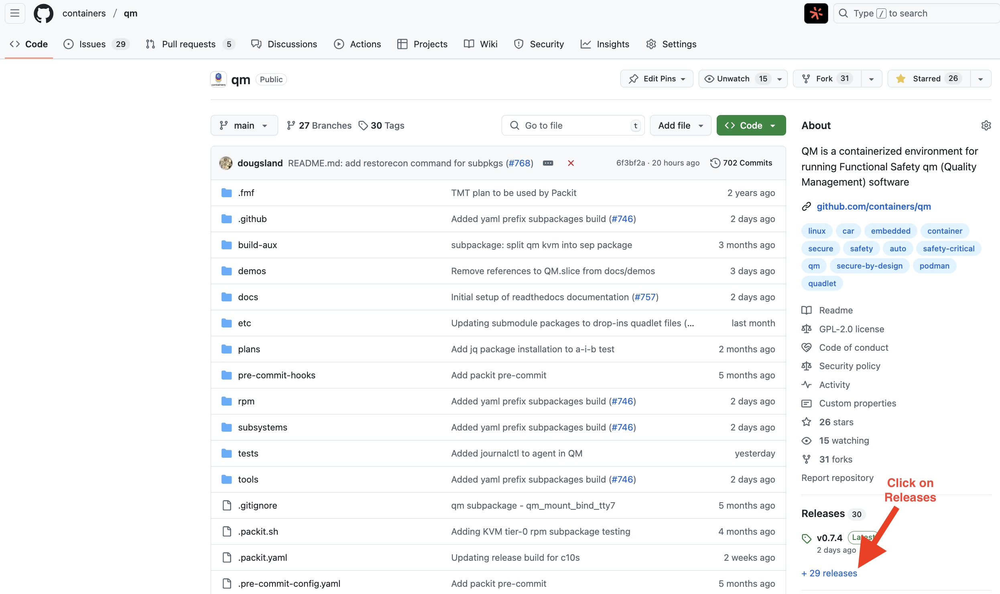
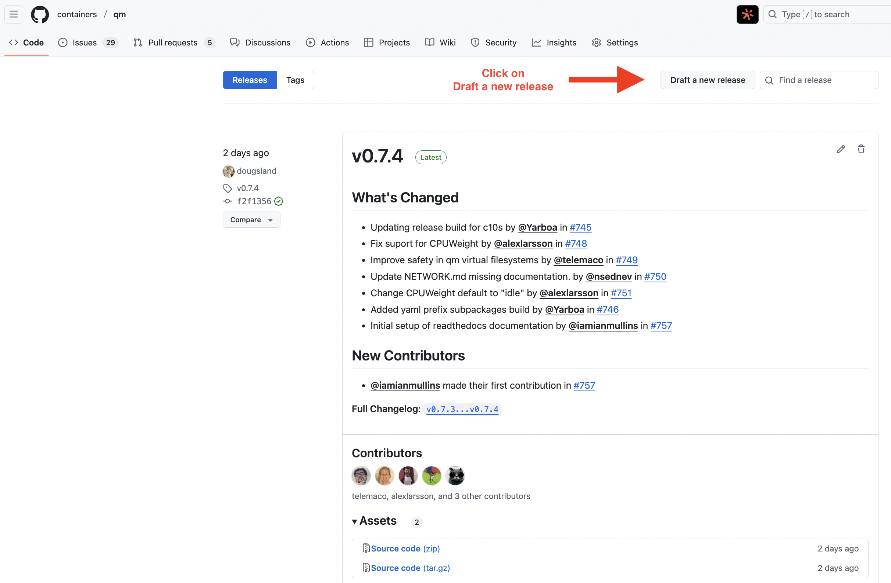
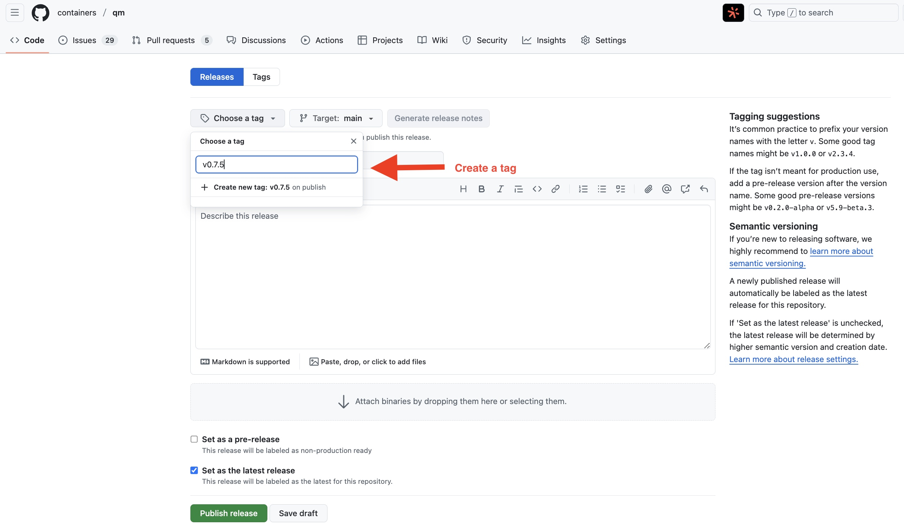
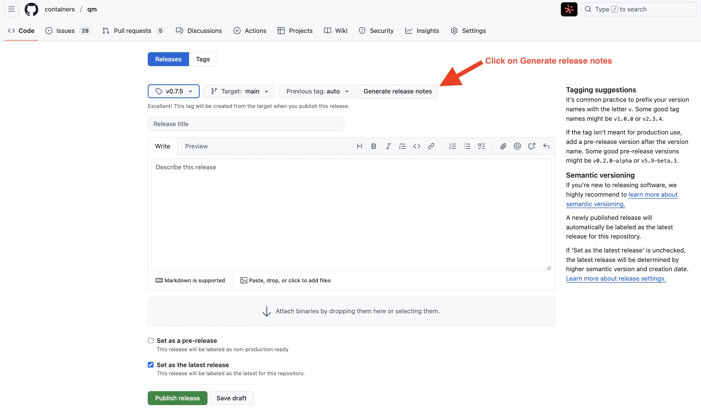
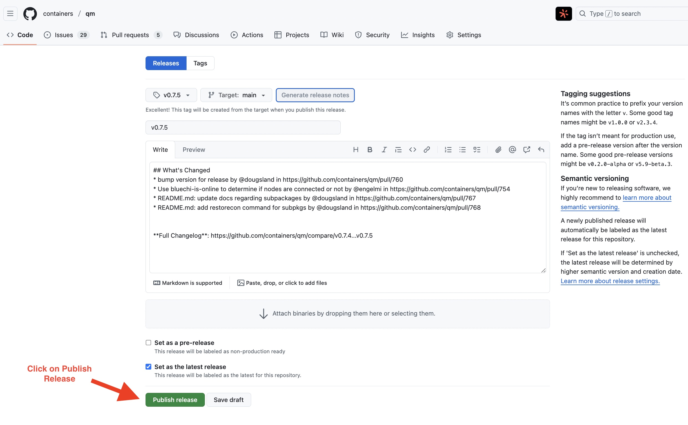

# Maintainer documentation

## Creating a new release

Initially, bump **VERSION** in the git repo to the next release, e.g. `2.1`.
After that, follow the steps below using GitHub UI.

**Create a new Release**

**Draft a new release**

**Create a new tag**

**Generate release notes**

**Publish Release**

